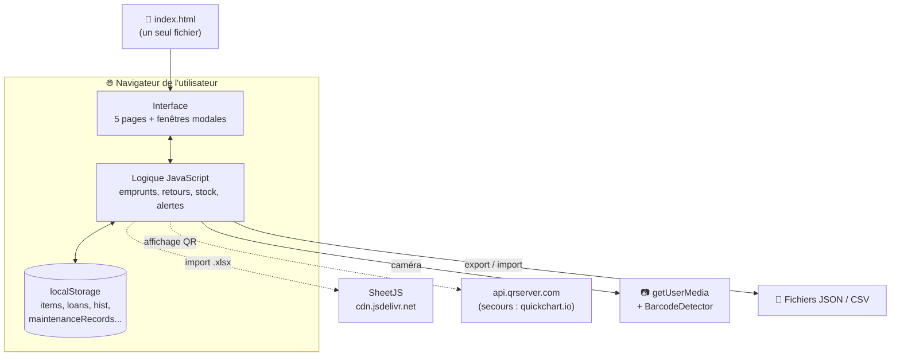
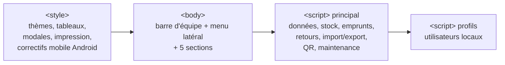
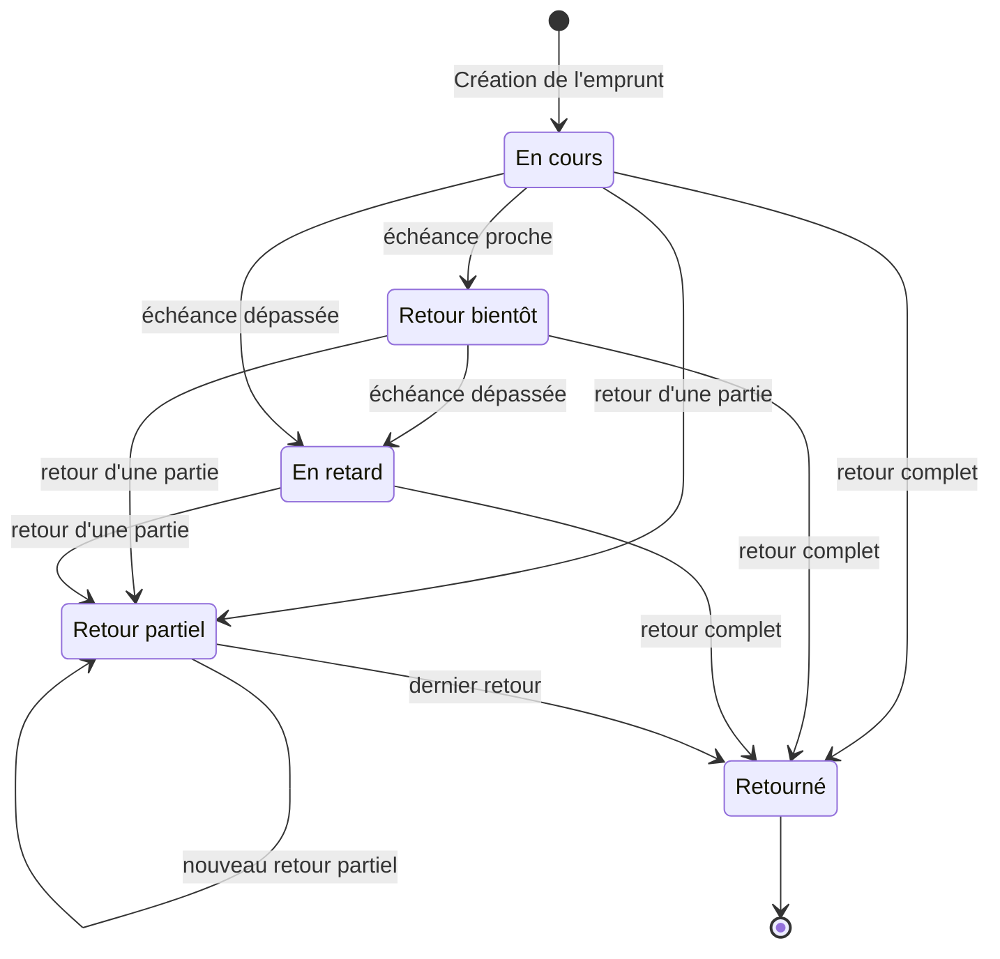
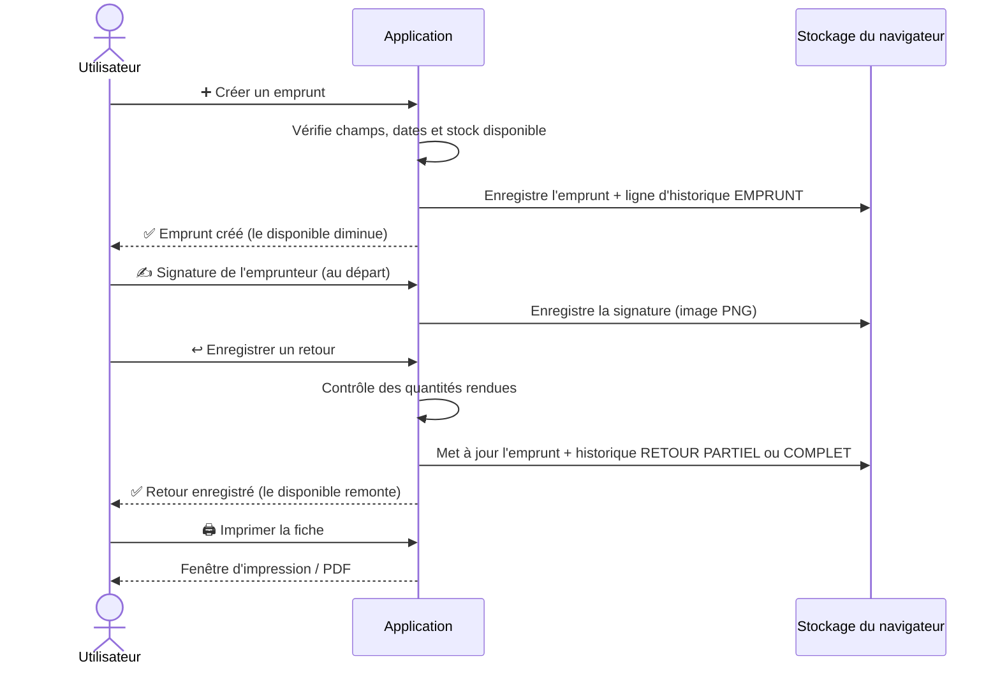
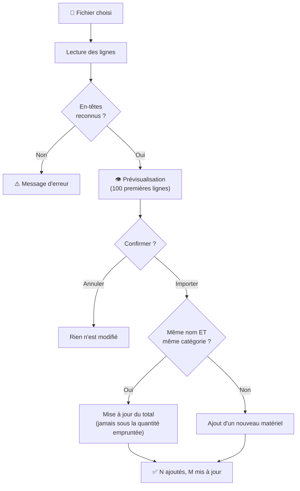
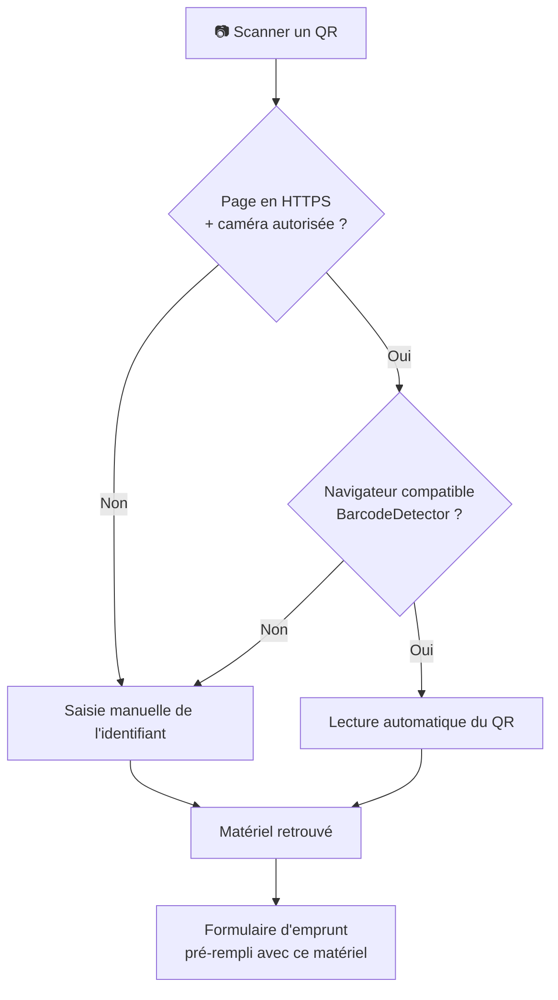
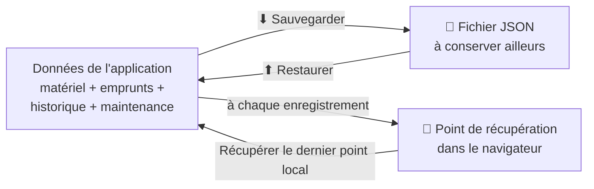
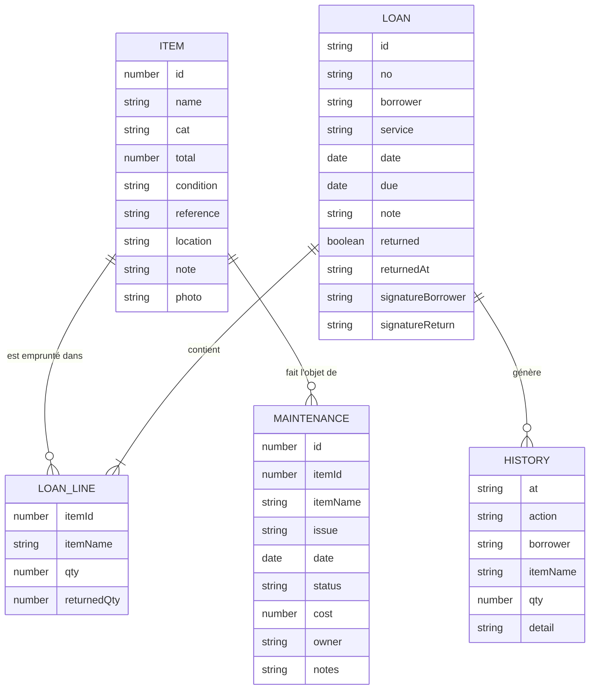

# 📦 Gestion du matériel — Med Num

Application web **tout-en-un** pour gérer le stock de matériel d'un lieu de médiation numérique : inventaire, emprunts multi-matériels, retours (même partiels), historique, maintenance, signatures numériques, QR codes, import/export Excel et sauvegardes.

Tout tient dans **un seul fichier** (`index.html`) : pas de serveur, pas d'installation, pas de base de données. Les données sont enregistrées **dans le navigateur** de l'appareil utilisé.

> ℹ️ Les éléments marqués **(test)** sont des fonctions pratiques mais pas encore fiabilisées, ou des données de démonstration. Ils sont détaillés dans la section [Limites connues](#-limites-connues).

---

## 📑 Sommaire

1. [Aperçu rapide](#-aperçu-rapide)
2. [Démarrage](#-démarrage)
3. [Architecture](#-architecture)
4. [Les 5 pages en détail](#-les-5-pages-en-détail)
5. [Cycle de vie d'un emprunt](#-cycle-de-vie-dun-emprunt)
6. [Règles de calcul](#-règles-de-calcul)
7. [Import / Export Excel et CSV](#-import--export-excel-et-csv)
8. [QR codes](#-qr-codes)
9. [Signatures et fiche imprimable](#-signatures-et-fiche-imprimable)
10. [Sauvegarde et restauration](#-sauvegarde-et-restauration)
11. [Utilisateurs et rôles (test)](#-utilisateurs-et-rôles-test)
12. [Modèle de données](#-modèle-de-données)
13. [Stockage local (clés)](#-stockage-local-clés)
14. [Services externes](#-services-externes)
15. [Limites connues](#-limites-connues)
16. [Dépannage](#-dépannage)
17. [Idées d'évolution](#-idées-dévolution)

---

## 👀 Aperçu rapide

| Fonction | Ce que ça fait |
|---|---|
| 🏠 **Tableau de bord** | Chiffres clés, alertes, actions prioritaires, activité récente, matériel le plus emprunté |
| 📦 **Matériel** | Inventaire avec recherche, filtres, tri, photos, fiches détaillées, QR codes |
| 📝 **Emprunts** | Création multi-matériels, suivi des statuts, retours partiels, signatures, impression |
| 📜 **Historique** | Journal de tous les mouvements (emprunts, retours, suppressions) |
| 🛠️ **Maintenance** | Suivi des pannes et réparations avec coûts |
| 💾 **Sauvegarde** | Export/restauration JSON + point de récupération local |
| 📥📤 **Excel / CSV** | Import de l'inventaire, export de l'inventaire et de la maintenance |
| 👥 **Profils** (test) | Plusieurs noms/rôles sur un même poste |

---

## 🚀 Démarrage

### Option 1 — En local (le plus simple)

1. Télécharger le dépôt (bouton **Code → Download ZIP** sur GitHub).
2. Décompresser le dossier.
3. Double-cliquer sur `index.html` : l'application s'ouvre dans le navigateur.

### Option 2 — En ligne avec GitHub Pages (recommandé pour le scan QR)

La caméra n'est autorisée par les navigateurs qu'en **HTTPS**. Pour l'utiliser :

1. Sur GitHub : **Settings → Pages**.
2. *Source* : **Deploy from a branch**, branche `main`, dossier `/ (root)`.
3. Ouvrir l'adresse `https://<ton-compte>.github.io/gestion-stock-mednum/`.

> ⚠️ Les données restent **par navigateur et par appareil** : ouvrir le site sur un autre ordinateur donne un inventaire différent (voir [Limites connues](#-limites-connues)).

### Connexion Internet : quand est-elle nécessaire ?

| Fonction | Internet requis ? |
|---|---|
| Utiliser l'application, créer des emprunts, retours, maintenance | ❌ Non |
| Import d'un fichier **.xlsx / .xls** (bibliothèque SheetJS) | ✅ Oui (au chargement de la page) |
| Import d'un fichier **.csv** | ❌ Non |
| Afficher un QR code (génération) | ✅ Oui |

---

## 🧱 Architecture

L'application est une **page unique** en HTML / CSS / JavaScript « vanilla » (sans framework, sans compilation).



### Structure du dépôt

```
gestion-stock-mednum/
├── index.html   ← toute l'application (HTML + CSS + JavaScript)
└── README.md    ← ce document
```

### Organisation interne de `index.html`



### Disposition de l'écran

```
┌────────────────────────────────────────────────────────────────┐
│ 👤 Administrateur · Admin   [👥 Utilisateurs] [⬇ Sauvegarder]  │  ← barre d'équipe
│                              [⬆ Restaurer une sauvegarde]      │
├──────────────┬─────────────────────────────────────────────────┤
│ 📦 MATÉRIEL  │                                                 │
│              │   Titre de la page                              │
│ 🏠 Tableau   │   ┌─────────┐ ┌─────────┐ ┌─────────┐ ┌──────┐ │
│    de bord   │   │ Chiffres│ │ clés    │ │         │ │      │ │
│ 📦 Matériel  │   └─────────┘ └─────────┘ └─────────┘ └──────┘ │
│ 📝 Emprunts  │                                                 │
│ 📜 Historique│   Tableaux, filtres, boutons d'action           │
│ 🛠️ Maintenance│                                                │
│              │                                                 │
│ [➕ Créer un │                                                 │
│   emprunt]   │                                                 │
└──────────────┴─────────────────────────────────────────────────┘
   menu latéral                  zone principale
```

---

## 🗂️ Les 5 pages en détail

### 🏠 1. Tableau de bord

C'est la page d'accueil. Elle se met à jour à l'ouverture et via le bouton **↻ Actualiser**.

| Bloc | Contenu |
|---|---|
| **Cartes** | *Articles* (nombre de références), *Matériel total* (somme des quantités), *Disponible*, *Emprunté* |
| **⚠️ À surveiller** | Liste des alertes (voir tableau ci-dessous) avec boutons d'action directs |
| **📊 Catégories** | Pour chaque catégorie : `disponibles / total` |
| **🧭 Actions prioritaires** | Les alertes classées par urgence, chacune avec un bouton qui ouvre la bonne page déjà filtrée |
| **🕘 Activité récente** | Les 5 derniers mouvements |
| **🏆 Matériel le plus emprunté** | Top 5 d'après les mouvements EMPRUNT / RETOUR de l'historique |
| **📈 Statistiques d'activité** | Nombre d'emprunts, nombre rendus, taux de retour, interventions de maintenance ouvertes |
| **⚙️ Paramètres des alertes** | Seuils réglables (voir ci-dessous) |
| **🛡️ Protection des données** | Date de la dernière sauvegarde téléchargée + point de récupération local |

**Types d'alertes**

| Alerte | Déclenchée quand… | Couleur |
|---|---|---|
| 🔴 En retard | la date de retour prévue est dépassée | rouge |
| 🟠 Retour à anticiper | le retour est prévu dans les *N* prochains jours | orange |
| 📅 Sans échéance | un emprunt actif n'a pas de date de retour | orange |
| 📉 Stock faible | le disponible d'une référence est ≤ au seuil | neutre |
| 🔧 À vérifier | l'état d'un matériel est différent de « Disponible » | orange |
| ↩️ Retour partiel | une partie seulement du matériel a été rendue | info |

Un **badge numérique** sur « Tableau de bord » dans le menu rappelle le nombre d'alertes à traiter.

**Paramètres des alertes**

| Réglage | Valeurs possibles | Par défaut |
|---|---|---|
| Seuil de stock faible | 0, 1, 2, 3, 5 | **2** |
| Délai « retour bientôt » | 1, 3, 5, 7, 14 jours | **3** |

---

### 📦 2. Matériel

L'inventaire complet.

**Barre d'outils**

| Bouton | Action |
|---|---|
| 📝 Créer un emprunt | Ouvre le formulaire d'emprunt |
| 📷 Scanner un QR | Ouvre le scanner (voir [QR codes](#-qr-codes)) |
| 📥 Importer Excel | Importe un fichier .xlsx / .xls / .csv |
| 📤 Exporter Excel/CSV | Télécharge l'inventaire en CSV |
| ➕ Ajouter matériel | Ouvre la fiche de création |

**Recherche, filtres et tri**

| Contrôle | Options |
|---|---|
| 🔎 Recherche | Nom, catégorie, état, référence, emplacement, notes, description, identifiant — **sans tenir compte des accents ni des majuscules** |
| Catégorie | Liste construite automatiquement à partir de l'inventaire |
| Disponibilité | Disponible · Partiellement disponible · Aucun disponible · Stock faible |
| État | Disponible · Abîmé · En réparation · Perdu · Indisponible |
| Tri | Nom A→Z · Nom Z→A · Disponibilité décroissante · Stock total décroissant · Catégorie A→Z |
| Réinitialiser | Remet tous les filtres à zéro |

Un compteur affiche « *X matériel(s) affiché(s) sur Y* ».

**Colonnes du tableau** : nom (avec miniature, référence et emplacement), catégorie, total, emprunté, disponible, état, statut de disponibilité (avec barre de progression) et actions 👁️ fiche · ✏️ modifier · 🗑️ supprimer.

**Fiche matériel (👁️)** : photo, stock total / emprunté / disponible / % de disponibilité, catégorie, référence, emplacement, état, description, **emprunts en cours** pour ce matériel, **historique récent** (8 derniers mouvements) et boutons *Modifier*, *QR code*, *Emprunter* (désactivé s'il n'y a plus d'exemplaire).

**Champs d'un matériel**

| Champ | Obligatoire | Détail |
|---|---|---|
| Nom | ✅ | |
| Catégorie | ✅ | texte libre |
| Quantité totale | ✅ | nombre entier |
| Référence / code inventaire | | sert aussi à retrouver le matériel via QR |
| Emplacement | | ex. armoire, salle… |
| État | | Disponible par défaut |
| Description / notes | | |
| Photo | | compressée automatiquement avant enregistrement |

---

### 📝 3. Emprunts

**Barre de recherche + filtre de statut** : *Tous · En cours · Retour partiel · En retard · Retour bientôt · Retourné*.

**Créer un emprunt** (bouton ➕, ou « Emprunter » depuis une fiche matériel, ou après un scan QR) :

| Champ | Obligatoire | Détail |
|---|---|---|
| N° d'emprunt | ✅ | proposé automatiquement (`0001`, `0002`…), modifiable |
| Emprunteur | ✅ | |
| Service / structure | | ex. « médiation numérique » |
| Date de sortie | ✅ | aujourd'hui par défaut |
| Retour prévu | ✅ | doit être ≥ date de sortie |
| Matériels | ✅ (≥ 1) | recherche par nom ou catégorie, choix d'une quantité, ajout/retrait de lignes |
| Remarque / consignes | | |

Contrôles à la validation : tous les champs obligatoires remplis, au moins un matériel, dates cohérentes, et **quantité demandée ≤ quantité disponible**.

Un **scanner QR intégré** au formulaire permet d'ajouter un matériel en le scannant.

**Tableau des emprunts** : n°, emprunteur, matériel (avec quantités), dates, retard/délai restant, quantité totale, statut, et actions 👁️ voir la fiche · ↩️ enregistrer un retour · 🗑️ supprimer.

**Enregistrer un retour (↩️)** — total ou partiel :

| Pour chaque ligne | Détail |
|---|---|
| Quantité rendue maintenant | de 0 à la quantité restante (pré-remplie avec tout le restant) |
| État au retour | Bon état · Abîmé · À réparer · Manquant / non rendu |
| Commentaire | facultatif, pour tout le retour |

Les quantités non rendues **restent sur l'emprunt**. L'état constaté et le commentaire sont **conservés dans l'historique**.

> ℹ️ L'état choisi au retour est **noté dans l'historique** mais ne modifie pas automatiquement l'état de la fiche matériel. Pour qu'un matériel abîmé n'apparaisse plus comme disponible, modifie sa fiche (✏️) et change son état.

---

### 📜 4. Historique

Journal chronologique (le plus récent en haut) avec recherche par emprunteur, matériel ou action.

| Colonne | Contenu |
|---|---|
| Date | date et heure |
| Action | `EMPRUNT`, `RETOUR PARTIEL`, `RETOUR COMPLET`, `SUPPRESSION` |
| Emprunteur | |
| Matériel | liste avec quantités |
| Qté | quantité totale du mouvement |
| Détail | n° d'emprunt, états constatés, commentaire |

---

### 🛠️ 5. Maintenance

Suivi des pannes, réparations et interventions.

**Cartes** : interventions ouvertes · terminées · coût déclaré total · nombre de matériels concernés.

**Déclarer une intervention**

| Champ | Obligatoire | Détail |
|---|---|---|
| Matériel | ✅ | choisi dans l'inventaire |
| Problème / intervention | ✅ | |
| Date | | aujourd'hui par défaut |
| Statut | | `Ouverte` · `En cours` · `Terminée` |
| Coût (€) | | nombre positif ou nul |
| Responsable | | |
| Notes | | |

Recherche + filtre par statut, modification (✏️), suppression (🗑️), et **📤 Exporter le suivi** en CSV.

> ℹ️ La maintenance est un suivi **indépendant** de l'état du matériel : déclarer une intervention ne change pas l'état de la fiche.

---

## 🔄 Cycle de vie d'un emprunt



### Parcours complet



---

## 🧮 Règles de calcul

| Notion | Règle |
|---|---|
| **Emprunté** (d'un matériel) | somme, sur tous les emprunts, des quantités **restant à rendre** |
| **Disponible** | si l'état est « Disponible » : `total − emprunté` (jamais négatif) ; **sinon : 0** |
| **Statut de disponibilité** | `Indisponible` si dispo = 0 · `Partiellement disponible` si dispo < total · `Disponible` sinon |
| **Emprunt terminé** | toutes les quantités sont rendues |
| **Statut d'un emprunt** | Retourné → Retour partiel → En retard (échéance passée) → Retour bientôt (≤ 3 jours) → En cours |

> 📌 Dans la liste des emprunts, le statut « Retour bientôt » utilise un délai fixe de **3 jours**. Le délai réglable (1 à 14 jours) s'applique aux **alertes du tableau de bord**.

---

## 📥📤 Import / Export Excel et CSV

### Importer l'inventaire

Formats : **.xlsx**, **.xls**, **.csv** (séparateur `;` ou `,`). Pour un classeur Excel, l'onglet nommé **`Listes`** est lu en priorité, sinon le premier onglet.

**Colonnes reconnues** (accents et majuscules ignorés) :

| Donnée | Noms de colonne acceptés |
|---|---|
| Matériel | `Article`, `Nom`, `Matériel`, `Choix matériel`, `Désignation` |
| Catégorie | `Catégorie`, `Category`, `Famille` |
| Quantité | `Total`, `Quantité`, `Total max`, `Stock`, `Quantité totale` |

Exemple :

```csv
Article;Catégorie;Total
Raspberry Pi 3 Modèle B;Électronique;4
Câble HDMI;Électronique;4
Imprimante 3D;Impression 3D;2
```

**Comportement de l'import**



Les doublons dans le fichier sont ignorés, et les **emprunts en cours sont conservés**.

### Exporter

| Export | Fichier | Colonnes |
|---|---|---|
| Inventaire | CSV (séparateur `;`, encodage UTF-8 avec BOM pour Excel) | ID, Nom, Catégorie, Référence, Emplacement, Quantité totale, Emprunté, Disponible, État, Description |
| Maintenance | `suivi-maintenance.csv` | ID, Date, Matériel, Problème / intervention, Statut, Coût (€), Responsable, Notes |

> Les photos ne sont pas incluses dans les CSV : elles sont conservées dans la **sauvegarde JSON**.

---

## ▦ QR codes

### Générer le QR d'un matériel

Fiche matériel → bouton **▦ QR code**. Le QR contient :

```json
{ "type": "materiel", "id": 42, "reference": "INV-0042", "name": "Raspberry Pi 3 Modèle B", "category": "Électronique" }
```

Un bouton permet de **l'imprimer** pour l'étiqueter sur le matériel.

### Scanner



La saisie manuelle accepte l'**identifiant** ou la **référence** inscrite sur le QR.

> **(test)** Le scan automatique dépend du navigateur : il fonctionne bien sur **Chrome à jour (Android)**. Sur les navigateurs sans `BarcodeDetector`, utiliser la saisie manuelle.

---

## ✍️ Signatures et fiche imprimable

Dans la fiche d'un emprunt (👁️), deux zones de signature à dessiner **à la souris, au doigt ou au stylet** :

| Zone | Moment |
|---|---|
| Au départ — emprunteur | à la remise du matériel |
| Au retour — responsable / contrôle | au contrôle du matériel rendu |

Chaque signature est enregistrée automatiquement (image PNG) avec l'emprunt, et peut être effacée.

**🖨️ Imprimer la fiche** ouvre un document A4 prêt à imprimer ou à enregistrer en PDF : numéro, statut, emprunteur, service, dates, tableau du matériel, total à contrôler, remarques, date de retour effectif et signatures.

> Si rien ne s'ouvre, autoriser les **fenêtres contextuelles** (pop-ups) pour le site.

---

## 💾 Sauvegarde et restauration

Deux filets de sécurité complémentaires :



| Élément | Détail |
|---|---|
| **Sauvegarde JSON** | contient `app`, `version`, `exportedAt`, `items`, `loans`, `hist`, `maintenanceRecords` (photos et signatures comprises) |
| **Restauration** | fichier .json de **20 Mo maximum**, validé avant import ; remplace les données actuelles |
| **Point de récupération local** | copie automatique conservée tant qu'elle reste raisonnable en taille ; la date de la dernière sauvegarde téléchargée est visible dans « Protection des données » |

> ✅ **Bon réflexe** : télécharger une sauvegarde JSON régulièrement et avant de vider le navigateur. Les données ne vivent que dans le navigateur.

---

## 👥 Utilisateurs et rôles (test)

**(test)** Des **profils locaux** permettent de savoir « qui utilise l'application » sur un poste partagé. Le bouton **👥 Utilisateurs** (barre du haut) permet de :

- changer de profil actif ;
- (admin) ajouter un profil — nom unique, rôle au choix ;
- (admin) supprimer un profil (sauf l'admin et le profil actif).

| Rôle | Intention |
|---|---|
| **Administrateur** | gère les profils (un profil « Administrateur » est créé par défaut) |
| **Gestionnaire** | prévu pour les modifications courantes |
| **Lecture seule** | prévu pour la consultation |

> ⚠️ **Ce n'est pas une sécurité.** Les rôles sont affichés mais **ne bloquent aucune action** : un profil « Lecture seule » peut toujours tout modifier. Pour de vrais comptes, il faudra une base de données avec authentification côté serveur.

---

## 🗃️ Modèle de données



Remarques :

- `LOAN_LINE` correspond au tableau `items` de chaque emprunt (un emprunt = plusieurs lignes de matériel).
- `HISTORY` garde le **nom** du matériel au moment du mouvement ; renommer un matériel ne réécrit pas l'ancien historique.
- `photo`, `signatureBorrower` et `signatureReturn` sont des images encodées en texte (base64).

---

## 🧠 Stockage local (clés)

Tout est dans le `localStorage` du navigateur.

| Clé | Contenu |
|---|---|
| `items` | inventaire |
| `loans` | emprunts |
| `hist` | historique |
| `maintenanceRecords` | interventions de maintenance |
| `dataVersion` | version du jeu de données de départ (`excel-126-v1`) |
| `lastLocalBackup` | point de récupération local |
| `lastExportedBackupAt` | date de la dernière sauvegarde téléchargée |
| `dashboardAlertSettings` | seuils d'alerte du tableau de bord |
| `materielTeamUsersV1` | profils utilisateurs (test) |
| `materielTeamActiveV1` | profil actif (test) |

### Données de départ **(test)**

Au premier lancement, l'application est pré-remplie avec une liste de départ issue d'un listing Excel (**126 références**), complétée par **38 fiches supplémentaires** ajoutées uniquement si leur nom n'existe pas déjà. Ces données servent de **démonstration** : à adapter à ton propre stock (modifier, supprimer ou réimporter).

---

## 🌍 Services externes

| Service | Utilité | Sans lui… |
|---|---|---|
| `cdn.jsdelivr.net` — **SheetJS 0.18.5** | lire les fichiers Excel | l'import .xlsx échoue → utiliser un **CSV** |
| `api.qrserver.com` | générer l'image du QR code | bascule sur `quickchart.io` ; si les deux échouent, un message l'indique |
| `quickchart.io` | génération de QR (secours) | idem |

Aucune donnée d'inventaire n'est envoyée à un serveur applicatif : l'application n'en a pas. Seul le **contenu du QR** (id, référence, nom, catégorie) est transmis au service de génération d'image.

---

## ⚠️ Limites connues

| Limite | Explication | Contournement |
|---|---|---|
| **Pas de synchronisation** | chaque navigateur/appareil a ses propres données | sauvegarde JSON → restauration sur l'autre appareil |
| **Espace limité** | le stockage du navigateur est restreint (quelques Mo) ; les photos et signatures en consomment | photos légères, sauvegardes régulières |
| **Données perdues si le navigateur est vidé** | cache/données de site supprimés = inventaire effacé | **sauvegarde JSON régulière** |
| **Rôles non appliqués (test)** | aucune restriction réelle par profil | ne pas s'y fier pour la sécurité |
| **Scan QR (test)** | dépend de `BarcodeDetector` et du HTTPS | saisie manuelle de l'identifiant |
| **État au retour non répercuté** | l'état noté au retour reste dans l'historique | modifier la fiche matériel |
| **Délai « bientôt » fixe dans la liste** | 3 jours dans *Emprunts*, réglable dans les alertes du tableau de bord | — |
| **Données de départ (test)** | liste de démonstration pré-chargée | adapter ou réimporter |

---

## 🩺 Dépannage

| Problème | Cause probable | Solution |
|---|---|---|
| « Enregistrement impossible : espace de stockage insuffisant » | trop de photos / signatures | télécharger une sauvegarde, réduire ou retirer des photos |
| Le scan QR ne démarre pas | page ouverte en `file://` ou en HTTP, caméra refusée | ouvrir via **HTTPS** (GitHub Pages), autoriser la caméra |
| « Ce navigateur ne lit pas les QR codes » | pas de `BarcodeDetector` | utiliser Chrome à jour sur Android, ou la saisie manuelle |
| L'import Excel échoue | pas de connexion au chargement, ou colonnes non reconnues | se connecter, ou enregistrer en **CSV** ; vérifier `Article`, `Catégorie`, `Total` |
| Le QR ne s'affiche pas | services de génération injoignables | vérifier la connexion Internet |
| L'impression ne s'ouvre pas | pop-ups bloqués | autoriser les fenêtres contextuelles |
| « Stock insuffisant » à la création | quantité demandée > disponible (ou matériel pas à l'état « Disponible ») | réduire la quantité ou vérifier l'état de la fiche |
| Les données ont disparu | navigateur ou profil différent, données de site vidées | **Restaurer une sauvegarde** ou « Récupérer le dernier point local » |

---

## 💡 Idées d'évolution

- 🔐 Vrais comptes et droits (base de données + authentification, par ex. Supabase ou Firebase)
- ☁️ Synchronisation entre appareils
- 🏷️ Planche d'étiquettes QR à imprimer en lot
- 🔁 Répercuter automatiquement l'état « Abîmé / À réparer » du retour sur la fiche matériel
- 📬 Rappels automatiques des retours en retard

---

## 📄 Licence

(à définir)
